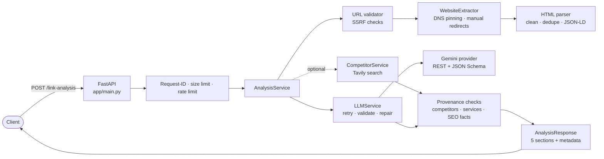

# AI Website Link Analysis API

A FastAPI service that takes a website URL, **fetches and reads the real page**, and uses an LLM to return a
structured, evidence-labelled analysis in five sections:

1. **Competitor vs your brand** (with provenance: *retrieved from source* vs *AI-unverified*)
2. **Top 5 target search queries** (Google, Facebook, Instagram, LinkedIn, X)
3. **SEO improvements** (keywords, title, meta description, supporting content)
4. **Top 5 services** (labelled *extracted* vs *inferred*)
5. **Target audience identification**

Built for the Dxora Technologies | CREST Python practical test.

**Live demo:** _not deployed yet — add the URL here after verifying `GET /health` on the deployed service._

---

## Contents

[Problem](#problem-statement) · [Features](#key-features) · [Stack](#technology-stack) · [Architecture](#architecture) ·
[Structure](#project-structure) · [Workflow](#data-processing-workflow) · [API](#api) · [Install](#local-installation) ·
[Configuration](#environment-configuration) · [Run](#running-the-application) · [Tests](#running-tests) ·
[Verification status](#verification-status) · [LLM selection](#llm-selection) · [Costs](#token-cost-calculation) ·
[Security](#security-considerations) · [Errors](#error-handling) · [Deploy](#deployment-render) · [Future work](#future-improvements)

## Problem statement

Given only a URL, produce a marketing/SEO analysis that is grounded in what the website *actually says*. The hard parts are
(a) reading arbitrary, untrusted websites safely, (b) getting reliable structured output from an LLM, and (c) not letting the
LLM present guesses — competitors in particular — as facts.

## Key features

* **Real content extraction** — async HTTPX + BeautifulSoup/lxml: title, meta description/keywords, H1–H3, Open Graph,
  canonical URL, JSON-LD, links, business names, contact details, cleaned and de-duplicated visible text (capped).
* **SSRF protection** — scheme/credential/port/hostname checks, DNS resolution with public-IP validation, **DNS pinning**,
  manual validated redirects, no proxy env, size/time/content-type limits.
* **LLM structured output** — JSON Schema sent to the model, every answer validated with Pydantic, one repair attempt,
  retries with exponential backoff, rate-limit/timeout handling, token tracking.
* **Research integrity** — competitor `evidence_type` / `source_urls` / `confidence` are **enforced in code**, not trusted from
  the LLM; unverified suggestions are stripped of websites, strengths and weaknesses; search volume is reported as
  `"unavailable"`, never estimated.
* **Prompt-injection defences** — website text is fenced by a per-request random delimiter, marker forgery is neutralised, the
  system prompt declares it untrusted, output is schema-validated, and injection-like text is flagged in `metadata`.
* **Operational hygiene** — JSON logs with secret redaction, request IDs, per-client rate limit, request-size limit,
  in-memory result cache, clean error envelope (no stack traces).
* **Provider abstraction** — switch model with `LLM_MODEL`; new providers plug into `PROVIDER_REGISTRY`.

## Technology stack

Python 3.11+ · FastAPI · Pydantic v2 / pydantic-settings · HTTPX · BeautifulSoup4 + lxml · Google Gemini (REST) ·
Tavily (optional) · pytest · Docker · Render.

## Architecture



## Project structure

```text
ai-link-analysis-api/
├── app/
│   ├── main.py                    # FastAPI app, routes, middleware, error handlers
│   ├── config.py                  # Settings from env / .env (secrets as SecretStr)
│   ├── schemas.py                 # Request, LLM-output and response models
│   ├── exceptions.py              # AppError hierarchy -> HTTP status + stable error codes
│   ├── services/
│   │   ├── website_extractor.py   # SSRF-safe fetching (pinning, redirects, limits)
│   │   ├── html_parser.py         # Pure HTML -> structured data (no network)
│   │   ├── llm_service.py         # Provider abstraction, Gemini adapter, retry/repair
│   │   ├── competitor_service.py  # Optional Tavily research + provenance enforcement
│   │   └── analysis_service.py    # Orchestration, prompts, assembly, caching
│   └── utils/
│       ├── validators.py          # URL/IP validation (stdlib only)
│       ├── log_config.py          # JSON logging + secret redaction
│       ├── rate_limit.py          # Sliding-window limiter
│       └── cache.py               # TTL cache
├── tests/                         # pytest; all external calls mocked
├── docs/LLM_RESEARCH.md           # Provider research, pricing, cost, selection
├── screenshots/                   # Add /docs screenshots here
├── .env.example · .gitignore · .dockerignore
├── requirements.txt · requirements-dev.txt · pytest.ini
├── Dockerfile · render.yaml
└── .github/workflows/tests.yml
```

`html_parser.py` is split from `website_extractor.py` so parsing can be tested with plain strings, away from networking.

## Data-processing workflow

1. **Validate** the URL syntax and policy (`parse_url`) — before any network or LLM work.
2. **Cache lookup** by normalized URL (repeat requests cost nothing).
3. **Fail fast** if no LLM key is configured (`503`), before fetching anything.
4. **Fetch**: resolve DNS → require *all* addresses public → connect to the validated IP (Host/SNI preserved) → validate every redirect → enforce size, time and content-type limits.
5. **Extract & clean**: parse metadata, headings, JSON-LD, links; strip noise; de-duplicate; cap length. Empty or unreadable pages stop here with a clear error — no analysis is invented.
6. **Research (optional)**: with `TAVILY_API_KEY`, retrieve third-party sources about the brand's competitors.
7. **Prompt**: compact, evidence-first, with nonce-fenced untrusted data.
8. **One LLM call** with the JSON Schema; validate with Pydantic; retry transient errors; one repair attempt on invalid output.
9. **Verify in code**: competitor provenance, service `extracted`/`inferred` labels, existing title/description from the page, search metrics `unavailable`.
10. **Respond** with the five sections plus `metadata` (extraction, tokens, research, limitations).

## API

| Method | Path | Description |
|---|---|---|
| `GET` | `/` | API information |
| `GET` | `/health` | Liveness + non-secret config status (always `200`; shows whether keys are configured) |
| `POST` | `/link-analysis` | Analyze a website |
| `GET` | `/docs` | Interactive OpenAPI documentation |

### Request

```bash
curl -X POST http://localhost:4000/link-analysis \
  -H "Content-Type: application/json" \
  -d '{"url": "https://example.com"}'
```

```json
{ "url": "https://example.com" }
```

`url` must be a public `http(s)` URL (a missing scheme defaults to `https://`).

### Response (illustrative shape — abridged)

> This example shows the **structure and field semantics**. It was written by hand for this README; it is **not** captured
> output from a live run. Replace it with a real response after your first successful call.

```json
{
  "success": true,
  "website": "https://example.com",
  "brand": {
    "name": "Example Brand",
    "category": "Cloud and DevOps consulting",
    "summary": "…evidence-based summary…",
    "main_products": [],
    "main_services": ["Cloud Migration", "DevOps Automation"],
    "target_market": "Mid-size companies",
    "contact": { "emails": ["hello@example.com"], "phones": [], "addresses": [] },
    "social_links": []
  },
  "analysis": {
    "competitor_analysis": {
      "your_brand": { "name": "Example Brand", "overview": "…", "category": "…", "main_products": [], "main_services": ["…"], "target_market": "…", "competitive_advantages": ["…"] },
      "research_status": "ai_unverified",
      "research_note": "Competitors are AI-generated candidates and are unverified: External research is not configured (set TAVILY_API_KEY to enable it).",
      "competitors": [
        {
          "name": "Some Competitor",
          "website_url": null,
          "overview": "…",
          "main_offerings": [],
          "target_market": null,
          "source_backed_facts": [],
          "strengths": [],
          "weaknesses_or_gaps": [],
          "comparison_with_brand": "…",
          "positioning_opportunities": [],
          "evidence_type": "ai_unverified_suggestion",
          "source_urls": [],
          "confidence": "low",
          "verification_note": "AI-generated candidate; not verified against any external source. Website, strengths and weaknesses are intentionally omitted."
        }
      ],
      "market_positioning_opportunities": ["…"]
    },
    "target_search_queries": [
      {
        "query": "aws migration consultant for mid-size company",
        "platforms": ["google", "linkedin"],
        "search_intent": "commercial",
        "business_relevance": "…",
        "target_audience": "…",
        "metrics": { "search_volume": "unavailable", "keyword_difficulty": "unavailable", "ranking": "unavailable", "note": "…" }
      }
    ],
    "seo_improvements": {
      "keyword_recommendations": { "primary_keyword": "…", "secondary_keywords": ["…"], "long_tail_keywords": ["…"], "business_keywords": ["…"] },
      "seo_title": { "existing_title": "<from the page>", "recommended_title": "…", "primary_keyword": "…", "reason": "…" },
      "meta_description": { "existing_description": "<from the page>", "recommended_description": "…", "keywords": ["…"], "relevance_explanation": "…" },
      "supporting_content": { "service_landing_pages": [], "industry_pages": [], "faq_topics": [], "blog_topics": [], "location_pages": [], "supporting_articles": [] }
    },
    "top_services": [
      { "name": "Cloud Migration", "description": "…", "target_industry": "…", "target_customer": "…", "main_benefit": "…", "evidence": "Listed under 'Our services'", "origin": "extracted", "verification_note": null }
    ],
    "target_audience": {
      "primary_audience": { "name": "…", "description": "…", "why_relevant": "…" },
      "secondary_audience": { "name": "…", "description": "…", "why_relevant": "…" },
      "industry_segments": [], "business_types": [], "customer_profiles": [],
      "geographic_focus": { "regions": [], "basis": "No geographic focus is evident on the page." },
      "customer_requirements": [], "customer_challenges": [], "potential_interests": [],
      "recommended_marketing_segments": []
    }
  },
  "metadata": {
    "analyzed_at": "2026-11-25T10:00:00Z",
    "cached": false,
    "extraction": { "final_url": "https://example.com", "status_code": 200, "content_type": "text/html", "redirects": [], "bytes_fetched": 0, "fetch_ms": 0, "text_chars": 0, "text_truncated": false, "content_quality": "full", "warnings": [] },
    "llm": { "provider": "gemini", "model": "gemini-3.8-flash", "input_tokens": null, "output_tokens": null, "thinking_tokens": null, "attempts": 1, "repaired": false, "latency_ms": 0, "estimated_cost_usd": null, "cost_note": "…" },
    "research": { "provider": null, "status": "unavailable", "queries": [], "sources": [], "note": "External research is not configured (set TAVILY_API_KEY to enable it)." },
    "limitations": ["…"]
  }
}
```

**Evidence labels**

| Field | Values | Meaning |
|---|---|---|
| `competitors[].evidence_type` | `retrieved_from_source` | Named in retrieved third-party sources, which are listed in `source_urls` |
| | `ai_unverified_suggestion` | LLM suggestion only; no website, sources, strengths or weaknesses are returned |
| `competitors[].confidence` | `low` / `medium` | Derived from the number of independent source hosts — **never** taken from the LLM |
| `top_services[].origin` | `extracted` / `inferred` | `extracted` is downgraded to `inferred` (with a note) if the page text does not contain the service |
| `competitor_analysis.research_status` | `externally_sourced` · `partially_sourced` · `ai_unverified` · `unavailable` | Overall competitor reliability |

## Local installation

Requires Python 3.11+.

```bash
git clone <your-repo-url> ai-link-analysis-api && cd ai-link-analysis-api
python -m venv .venv && source .venv/bin/activate      # Windows: .venv\Scripts\activate
pip install -r requirements-dev.txt
cp .env.example .env                                   # then edit .env
```

## Environment configuration

Settings come from environment variables or `.env` (never commit `.env`; `.env.example` is the template).

| Variable | Default | Purpose |
|---|---|---|
| `GEMINI_API_KEY` | — | **Required** for analysis. Create one at <https://aistudio.google.com/api-keys> |
| `LLM_PROVIDER` / `LLM_MODEL` | `gemini` / `gemini-3.8-flash` | Provider and model (blank model = provider default) |
| `LLM_THINKING_LEVEL` | `low` | `low`/`medium`/`high`; blank omits it (for models without thinking levels) |
| `LLM_TIMEOUT` · `LLM_MAX_RETRIES` · `LLM_MAX_OUTPUT_TOKENS` | `90` · `2` · `8192` | LLM call limits |
| `LLM_PROMPT_MAX_CHARS` | `24000` | Page text sent to the LLM (cost control) |
| `LLM_INPUT_PRICE_PER_MTOK` / `LLM_OUTPUT_PRICE_PER_MTOK` | blank | Optional; enables `estimated_cost_usd` in metadata |
| `TAVILY_API_KEY` | blank | Optional; enables source-backed competitor research |
| `REQUEST_TIMEOUT` | `20` | Overall seconds to fetch a page, redirects included |
| `MAX_CONTENT_LENGTH` · `MAX_REDIRECTS` · `MAX_RESPONSE_BYTES` | `50000` · `3` · `3000000` | Extraction limits |
| `RATE_LIMIT_PER_MINUTE` | `10` | Per-client limit on `/link-analysis` (`0` disables) |
| `TRUST_PROXY_HEADERS` | `false` | Use `X-Forwarded-For` for rate limiting — enable **only** behind a trusted proxy (Render) |
| `CACHE_TTL_SECONDS` | `900` | In-memory cache (`0` disables) |
| `PORT` · `LOG_LEVEL` · `APP_ENV` · `APP_NAME` | `4000` · `INFO` · `development` · … | App settings |

## Running the application

```bash
uvicorn app.main:app --host 0.0.0.0 --port 4000        # local
# or: python -m app.main                               # uses PORT (default 4000)
uvicorn app.main:app --host 0.0.0.0 --port ${PORT:-4000}   # production form
```

* API: <http://localhost:4000> · Docs: <http://localhost:4000/docs> · Health: <http://localhost:4000/health>
* Without `GEMINI_API_KEY` the server starts normally; `POST /link-analysis` returns `503 llm_not_configured` with instructions.

## Running tests

```bash
pytest
```

Tests mock **all** external calls (`httpx.MockTransport`, fake DNS resolver, fake LLM/research); they need no network, no API keys and
make no paid calls. They cover URL/SSRF validation, extraction (valid/missing/empty/invalid HTML, HTTP failure, timeout, oversize,
unsupported type, unsafe redirects, DNS rebinding), the LLM layer (retry, backoff, repair, schema fallback, Gemini request shape),
competitor provenance, the five-section output, prompt hardening, caching, and every API error mapping.

## Verification status

> Update this section with your real results before submitting.

| Item | Status |
|---|---|
| URL/SSRF validator, HTML parser, rate limiter, cache, log redaction | Executed in the authoring sandbox (stdlib + BeautifulSoup only) and passing |
| LLM retry / backoff / repair / schema-fallback / error-mapping logic | Executed in the sandbox against a scripted fake provider (third-party imports stubbed) and passing |
| Full `pytest` suite with real FastAPI / Pydantic / HTTPX | Passed locally with the declared development dependencies (`pytest -q`) |
| Server start and `/health` | Server started locally; `/health` returned `200` |
| `/docs` | Verified locally; returned `200` |
| Screenshots | Not yet captured |
| Live Gemini call (request/response shape, `thinkingLevel`, schema acceptance) | **Not yet run** — needs your `GEMINI_API_KEY` |
| Docker build, Render deployment, public URL | **Not yet done** |

## LLM selection

Full research, sources and caveats: **[`docs/LLM_RESEARCH.md`](docs/LLM_RESEARCH.md)** (researched 2026-11-25 from official provider pages; no benchmarks were run).

| | OpenAI | Gemini | Anthropic |
|---|---|---|---|
| Model | GPT-6.1 Terra | **Gemini 3.8 Flash** | Claude Sonnet 5.5 |
| Input / output per 1M tokens | $1.00 / $5.00 | **$0.75 / $3.75** until 2026-12-31, then $1.50 / $7.50 | $2.00 / $10.00 |
| Context | 1,050,000 | 1,048,576 | 1,000,000 |
| Structured JSON | Yes | Yes (`responseJsonSchema`) | Yes |
| Free API tier | not stated | **yes** | not stated |

**Selected:** primary **`gemini-3.8-flash`**; fallback recommendation **`gpt-6.1-terra`**; budget option `gemini-3.5-flash-lite`.
Reasons: right quality tier for structured business analysis, free tier for the author/reviewers, native JSON-Schema output over plain REST,
and a per-analysis cost of a few cents. Only the Gemini adapter is implemented; the abstraction makes adding another a small change.

## Token-cost calculation

`cost = input_tokens/1e6 × input_price + output_tokens/1e6 × output_price`, with the assumption of **≈10,000 input / ≈5,000 output tokens** per analysis
(estimates — see the assumptions table in the research doc):

| Model | Per analysis | Per 1,000 |
|---|---|---|
| Gemini 3.8 Flash (to 2026-12-31) | ≈ $0.026 | ≈ $26 |
| Gemini 3.8 Flash (from 2027-01-01) | ≈ $0.053 | ≈ $53 |
| GPT-6.1 Terra (fallback) | ≈ $0.035 | ≈ $35 |
| Claude Sonnet 5.5 | ≈ $0.070 | ≈ $70 |
| Gemini 3.5 Flash-Lite / Haiku 5.5 / GPT-6 Luna | ≈ $0.0155 / $0.0035 / $0.0035 | ≈ $15.5 / $3.5 / $3.5 |

These are **estimates, not billing data**. Optional Tavily research costs 2 search credits per uncached analysis, reported separately.

## Cost optimization strategies

HTML cleaning and de-duplication before the LLM · hard caps on extracted text, prompt text and output tokens · bounded schema list sizes ·
compact evidence-only prompts · mid-tier model with `thinking_level=low` · **one** LLM call (at most one repair) · URL-keyed result cache ·
research only when configured · per-client rate limit. Details in the research doc §6.

## Security considerations

| Threat | Mitigation |
|---|---|
| SSRF to localhost / private / link-local / reserved / metadata addresses | `parse_url` blocks them (incl. IPv4-mapped, NAT64, 6to4, Teredo forms, decimal/hex/octal IP tricks, trailing-dot hostnames, `.local`/`.internal`, single-label names, Azure's *public* metadata IP) |
| Non-web schemes, credentials in URL, unusual ports | Only `http`/`https`; no `user:pass@`; only ports 80/443 |
| DNS pointing at internal IPs / DNS rebinding | We resolve, require **every** address to be public, then **connect to the validated IP** (Host header + TLS SNI/verification preserved) — no second lookup |
| Redirect to an internal target | Redirects are never auto-followed; each `Location` is re-validated; max `MAX_REDIRECTS` |
| Proxy env vars redirecting traffic | `trust_env=False` for website fetching |
| Huge / slow / non-HTML responses | Overall time budget, byte cap measured after decompression, content-type allow-list |
| Prompt injection from page content | Random-nonce fenced data, forged-marker neutralisation, "untrusted data" system rules, schema-validated output, injection-like text flagged in `metadata`; the LLM has no tools and no secrets in its prompt |
| Fabricated competitors/services/metrics | Provenance enforced in code (see *Evidence labels*); search metrics never estimated |
| Secret leakage | Keys are `SecretStr`, sent in headers (never URLs), redacted from logs, never returned; upstream error text is logged, not returned |
| Stack-trace / internal leakage | Uniform error envelope; unexpected errors return a generic `500` |
| LLM-budget abuse on a public deployment | Per-client rate limit, request-size limit, result cache |
| Container | Runs as a non-root user |

**Residual risks (be explicit):** validation runs in-process — in production also restrict the container's **egress** network from private ranges.
The rate limiter and cache are per-process (use Redis for multi-instance). `X-Forwarded-For` is only as trustworthy as your proxy.
Content extracted from a hostile site is still sent to the LLM; the defences reduce, but cannot eliminate, injection risk.

## Error handling

Errors use one envelope: `{"success": false, "error": {"code", "message", "details", "request_id"}}`.

| HTTP | `code` | When |
|---|---|---|
| 400 | `invalid_url` | Malformed URL |
| 400 | `url_not_allowed` | SSRF policy (scheme, credentials, port, internal/private address, unsafe redirect) |
| 413 | `request_too_large` | Request body above `MAX_REQUEST_BYTES` |
| 422 | `invalid_request` | Missing/invalid JSON body |
| 422 | `unsupported_content_type` · `response_too_large` · `empty_content` | Not HTML · too big · nothing readable (e.g. JS-only page) |
| 429 | `rate_limit_exceeded` | Per-client limit (`Retry-After` set) |
| 429 | `llm_rate_limited` | Provider rate limit after retries (`Retry-After` when provided) |
| 502 | `website_inaccessible` | DNS/connection failure, HTTP ≥ 400, redirect loop |
| 502 | `llm_auth_failed` · `llm_provider_error` · `llm_invalid_response` | Key rejected · provider error · output still invalid after one repair |
| 503 | `llm_not_configured` | No API key / unsupported provider |
| 504 | `website_timeout` · `llm_timeout` | Time budget exceeded |
| 500 | `internal_error` | Unexpected; generic message only |

## Deployment (Render)

`Dockerfile` and `render.yaml` are provided (not yet deployed or verified — see *Verification status*).

1. Push the repository to GitHub.
2. Render dashboard → **New → Blueprint** → select the repo (`render.yaml` is picked up).
3. Set the secret `GEMINI_API_KEY` (and optionally `TAVILY_API_KEY`) in the service's environment.
4. Deploy. The container listens on `0.0.0.0:$PORT`; health check path is `/health`.
5. Verify `https://<service>.onrender.com/health` and `/docs`, then put the URL at the top of this README.

Free instances may sleep when idle, so the first request can be slow. Keep `TRUST_PROXY_HEADERS=true` on Render so the rate limiter sees real client IPs.

Docker locally: `docker build -t ai-link-analysis-api . && docker run --rm -p 4000:4000 --env-file .env ai-link-analysis-api`

## Future improvements

* Add the fallback provider (OpenAI / Anthropic adapters) and automatic provider failover.
* Gemini **Grounding with Google Search** for source-backed competitor research without a separate search API.
* A keyword-data provider so search volume/difficulty can be reported with real data.
* Headless-browser rendering for JavaScript-only sites (behind the same SSRF controls).
* Multi-page crawl of key internal pages (services, about); Redis-backed cache and rate limiter; async job mode for long analyses.
* Live-API contract test and a small evaluation set to measure quality and latency per model.
